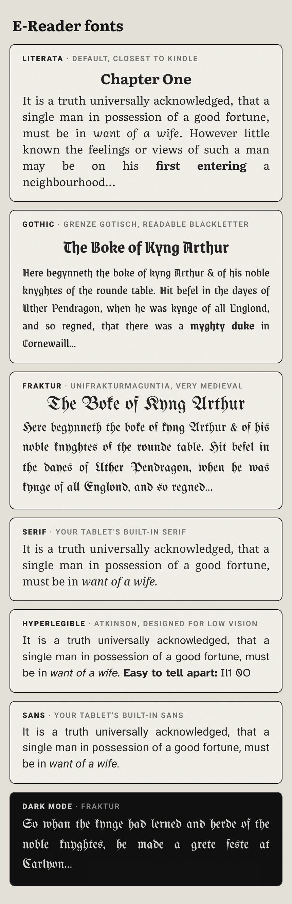

# E-Reader

An Android e-reader for tablets that looks and feels like a Kindle-style e-ink reader, with full S Pen support for writing, drawing and highlighting.

## Install

1. On your tablet, open the [latest release](../../releases/tag/latest) and download **E-Reader.apk**.
2. Open the downloaded file. If Android asks, allow your browser or file manager to install apps.
3. New builds install over the old one and keep your books, highlights and drawings.

Every push to the repository builds a fresh APK with GitHub Actions (see `.github/workflows/build.yml`).

### Updating from inside the app

The library checks for a newer build every few hours and shows a banner when one is ready (or use **⋮ › Check for updates**). Tap it, confirm, and Android installs the update over the current version. Nothing is uninstalled and your data stays.

- The first time, Android asks you to allow E-Reader to install apps ("Allow from this source"). This is a one-time switch.
- Updates come from this repository's public releases, so no account or token is needed. (If the repository is ever made private again, add a read-only token under **⋮ › Update settings**.)

## Reading

| Gesture | Action |
| --- | --- |
| Swipe left | Next page |
| Swipe right | Previous page |
| Tap the page | Show / hide the menu |
| Tap top-right corner | Bookmark this page |
| Long-press text (finger) | Select → highlight, excerpt, copy, share, look up |
| Long-press a PDF page (finger) | Select a region → save excerpt, copy text, highlight |
| Pinch | Zoom a PDF page, or change text size in books |
| Tap the page number | Cycle: page · time left in chapter · time left in book · location |
| Volume keys | Turn pages (can be turned off) |

Your **finger** only turns pages, selects and opens menus. Tap-to-turn (left/right side of the page) can be switched on in **⋮ › Pen & touch settings**. The **S Pen** only writes, draws, highlights and erases, and never turns pages. While the pen hovers near the screen, finger and palm touches are ignored.

## Formats

- **EPUB** (EPUB 2 and 3, with table of contents, images, basic styling, internal links)
- **MOBI / PRC** (DRM-free Mobipocket books, including HUFF/CDIC-compressed ones; Kindle Store books with DRM can't be opened by any app except Amazon's)
- **PDF** (rendered with Android's PDF engine; text copy needs Android 15+)
- **Word .docx** (headings, bold/italic/underline, lists, pictures, page breaks)
- Plain text and HTML

Old binary Word `.doc` files aren't supported. Save them as `.docx` first.

## S Pen

- Pens: ballpoint, fountain pen, calligraphy, pencil, marker, highlighter, each with its own color and thickness.
- Pressure: line width (and pencil darkness) follows how hard you press. Sensitivity is adjustable.
- Eraser: pick the eraser, or **hold the S Pen side button** while writing with any pen. Erasing over a text highlight removes it.
- Highlighter on text snaps to whole words and becomes a real highlight (can be turned off).
- Undo / redo on the toolbar: strokes, erasing, highlighter highlights, and adding, resizing or deleting writing spaces.
- Tap the selected pen again to change its color and thickness.

### Writing space

Tap the ⇕ button on the pen toolbar, then tap the page where you want room to write:

- In books, choose a small, half, large or full-page space. It stays attached to that spot in the text even if you change the font size.
- In PDFs, **split the page** at that point (the rest of the page moves to the next screen), or add a **blank page** after it.

Tap the **×** in a writing space's corner to delete it (an Undo button appears for a few seconds). Drag its bottom edge to resize it. Long-press it to switch between blank, lined, grid and dotted paper.

## Notebook and excerpts

- **Notebook** (open-book icon in the menu): all bookmarks, highlights and excerpts in the book. Tap any of them to jump to it; the passage is outlined so you can find it on the page.
- **Excerpts** tab in the library: excerpts from every book, newest first. Tap one to open the book at that exact spot.

## Sketchbooks

Library → **Sketchbooks** → **+** → **New sketchbook**. A sketchbook has 350 pages (add more from **⋮**) on blank, lined, grid or dotted paper.

- **Draw** with the S Pen using the same pens as the reader; hold the S Pen button (or pick the eraser) to erase. Undo and redo are on the pen toolbar.
- **Pages:** swipe with a finger, use the arrows, or tap the page number to jump to a page or to any page you've drawn on. Pinch to zoom.
- Everything is saved as you draw.

### Sharing between devices

Tap the **share** button in a sketchbook.

- **Keep in sync:** **Save to a shared folder…** and choose Google Drive (or another cloud folder). On your other device, go to Library → Sketchbooks → **+** → **Open shared sketchbook…** and pick the same file. From then on, drawing on either device shows up on both, including erasing; nothing is lost if both draw at the same time.
- **Send a copy:** sends a `.sketchbook` file by Quick Share, email or messages. Opening it in E-Reader adds the sketchbook, or merges it into the copy already there. **Send this page** sends a picture of the page, and **Save as PDF…** exports every drawn page.

## Appearance

- Light and dark mode, brightness, and a warm-light slider.
- Fonts: Literata (similar to Kindle's Bookerly), Serif, Atkinson Hyperlegible, Sans, **Gothic** (Grenze Gotisch blackletter) and **Fraktur** (UnifrakturMaguntia).


- Text size, line spacing, margins, justification and paragraph indents.
- Two pages side by side in landscape (books as two columns, PDFs as facing pages); can be turned off under **Aa**.
- E-ink effects: paper grain, page-refresh flash (off / every page / every 6 pages), optional ghosting, and pictures shown in 16 dithered grays like a real e-ink panel.

## Building

```
./gradlew assembleRelease
```

Requires JDK 17 and the Android SDK (compile SDK 35). The app uses only the Android framework, Kotlin coroutines and Jsoup.

The signing key `app/ereader.keystore` is committed on purpose so every build can update the installed app in place. It only protects this personal app; don't reuse it for anything else.

## Credits

Fonts are under the SIL Open Font License (see `app/src/main/assets/fonts/OFL-*.txt`): Literata, Atkinson Hyperlegible, Grenze Gotisch, UnifrakturMaguntia. Icons: Material Icons (Apache 2.0).
